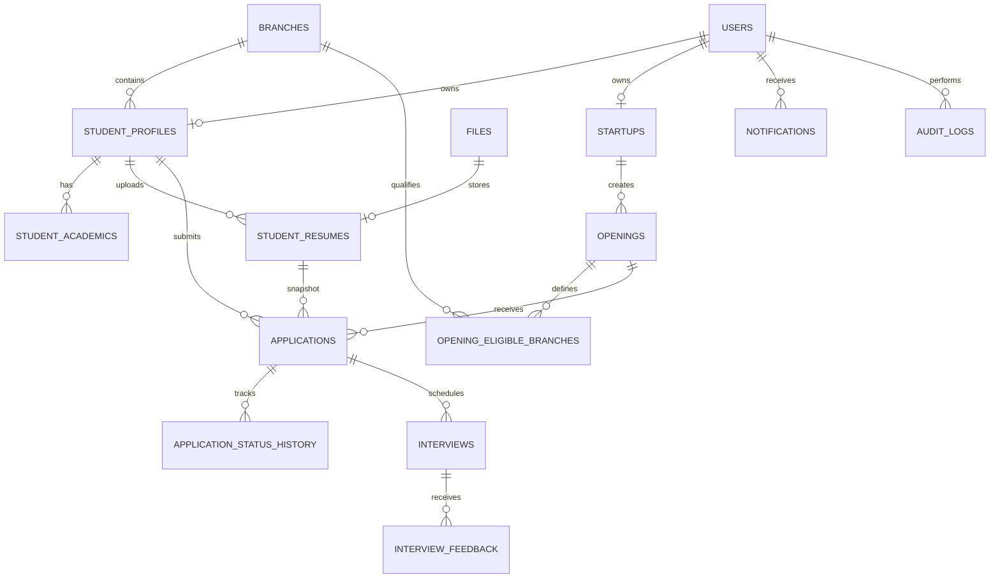

# SOFTWARE REQUIREMENTS SPECIFICATION (SRS)
## EDC Recruitment & Startup Engagement Portal
### Entrepreneurship Development Cell (EDC), Innovation and Incubation Hub
### Motilal Nehru National Institute of Technology Foundation, Prayagraj

**Document Version:** 1.0  
**Project Scope:** Version 1 (V1)  
**Document Type:** Software Requirements Specification and Database Design  
**Proposed Architecture:** Next.js Full-Stack Application  
**Authentication:** Clerk  
**Database:** PostgreSQL  
**ORM:** Prisma

---

# 1. INTRODUCTION

## 1.1 Purpose

The purpose of this document is to define the functional requirements, non-functional requirements, system architecture, business workflows, database architecture, and technical constraints of the EDC Recruitment and Startup Engagement Portal.

The proposed system will serve as a centralized digital platform for managing interactions between:

1. Students of Motilal Nehru National Institute of Technology Allahabad.
2. Startups associated with the Entrepreneurship Development Cell and Innovation and Incubation Hub.
3. EDC administrative and HR personnel responsible for managing student recruitment activities and startup onboarding.

The platform will digitize and centralize the processes of student profile management, startup onboarding, job and internship opening publication, application submission, application verification, shortlisting, and interview scheduling.

The system is intended to replace fragmented, manual recruitment workflows with a secure, efficient, transparent, and auditable digital solution.

This document will serve as the primary reference for backend development, frontend development, database implementation, testing, deployment, and future enhancements.

## 1.2 Project Overview

The EDC Recruitment Portal will be a unified web application consisting of three logically separated portals:

**A. Student Portal**

Provides students with a personal dashboard through which they can:
- Maintain their academic and personal profiles.
- Upload and manage resumes.
- View opportunities published by approved startups.
- Check eligibility for openings.
- Apply for internships and job opportunities.
- Track the status of their applications.
- View interview schedules and recruitment updates.

**B. EDC Admin/HR Portal**

Provides authorized EDC personnel with administrative capabilities to:
- View and manage student records.
- Review student applications.
- Verify or reject applications individually or in bulk.
- Approve or reject startup registrations.
- Approve or reject openings created by startups.
- View startup information and recruitment activities.
- Monitor application statistics and recruitment progress.
- Track interviews and recruitment outcomes.

**C. Startup Portal**

Provides an official login account for each registered startup through which it can:
- Maintain its company profile.
- Submit its registration for EDC approval.
- Create and manage job or internship openings.
- Define basic eligibility requirements.
- Submit openings for EDC approval.
- View applications verified by EDC.
- Review applicant profiles and resumes.
- Shortlist or reject applicants.
- Schedule interviews.
- Update recruitment decisions.

## 1.3 Objectives

The primary objectives are:

1. Establish a centralized recruitment management system.
2. Maintain a structured and reliable student database.
3. Provide startups with a standardized process for recruiting students.
4. Ensure that EDC retains control over startup onboarding and opening publication.
5. Ensure that startups can only access EDC-verified applications.
6. Automate basic eligibility checking.
7. Support individual and bulk application verification.
8. Maintain complete records of important recruitment activities.
9. Minimize unnecessary database queries and improve response times.
10. Provide a scalable architecture that can accommodate future expansion.

## 1.4 Scope

This specification covers the first version of the platform.

### Included in V1

- Clerk-based authentication.
- Local user and role management.
- Student profile management.
- Academic information management.
- Resume uploads and version management.
- Startup registration and approval.
- Single official login account per startup.
- Opening creation and EDC approval.
- Basic eligibility criteria.
- Student application submission.
- Automated eligibility evaluation.
- EDC application verification.
- Individual and bulk verification.
- Startup-side application viewing.
- Manual individual and bulk shortlisting.
- Interview scheduling and management.
- Notifications.
- Audit logging.
- Dashboard statistics.

### Explicitly excluded from V1

The following features are not part of the initial implementation:

- Student skills and skills-based matching.
- Multiple members or employees per startup.
- Startup employee invitations and membership management.
- Separate startup verification history module.
- AI-based candidate ranking.
- Weighted scoring and configurable shortlisting algorithms.
- Complex visual eligibility-rule builders.
- Automated resume parsing and AI resume analysis.
- Automated interview evaluation.
- Video conferencing infrastructure.
- Payroll and offer-letter generation.
- Full applicant tracking system integrations.
- Separate microservices.
- Advanced analytics and predictive recruitment.

These features may be considered in future versions without compromising the core database architecture.

## 1.5 Definitions and Terminology

| Term | Definition |
|---|---|
| EDC | Entrepreneurship Development Cell |
| IIH | Innovation and Incubation Hub |
| Student | An eligible institute student using the portal |
| Startup | An organization registered to recruit through EDC |
| Admin | An authorized administrative user |
| HR | An authorized recruitment-management user |
| Opening | A job or internship opportunity |
| Application | A student's submission for an opening |
| Eligibility | Whether a student satisfies an opening's criteria |
| Verification | Administrative approval of an application |
| Shortlisting | Startup's decision to move an applicant forward |
| Clerk | External authentication provider |
| Prisma | Database ORM |
| UUID | Universally Unique Identifier |

---

# 2. OVERALL SYSTEM DESCRIPTION

## 2.1 Product Perspective

The platform will operate as a centralized application with three role-specific interfaces.

All three interfaces will use a common backend and centralized PostgreSQL database.

The system will follow a modular monolithic architecture.

The frontend, backend business logic, and API endpoints will reside within the same Next.js application, but their responsibilities will remain logically separated.

The system will not require independent backend services for each portal.

## 2.2 Proposed Technology Stack

| Component | Technology | Responsibility |
|---|---|---|
| Frontend | Next.js | All three portals |
| Rendering | React Server Components | Efficient server-side data rendering |
| API | Next.js Route Handlers | Backend APIs |
| Authentication | Clerk | Identity and session management |
| Authorization | Application-level RBAC | Access control |
| Database | PostgreSQL | Persistent data storage |
| ORM | Prisma | Database operations |
| Validation | Zod | Request validation |
| File storage | S3-compatible private storage | Resumes and documents |
| Background processing | Optional Redis/BullMQ | Notifications and asynchronous tasks |
| API documentation | OpenAPI/Swagger | API documentation |
| Deployment | Docker | Application containerization |
| Reverse proxy | Nginx or hosting equivalent | Routing and HTTP configuration |

The application should use the Next.js App Router.

Server Components should be preferred for read-heavy pages, while Client Components should be used where interactive functionality is required.

Sensitive database operations must remain server-side.

## 2.3 User Classes

### 2.3.1 Student

A student can:
- Access their own profile.
- Update permitted profile information.
- Upload resumes.
- Browse approved openings.
- Apply for openings.
- View their applications.
- View recruitment status.
- View interview schedules.

A student cannot:
- View another student's private information.
- Modify application verification status.
- Modify startup decisions.
- Access admin functionality.
- Access startup-specific recruitment data.

### 2.3.2 Startup

A startup is represented by exactly one official login identity in V1.

A startup can:
- Register its official account.
- Maintain its startup profile.
- View its approval status.
- Create openings.
- Submit openings for approval.
- View its approved openings.
- View EDC-verified applications associated with its openings.
- View permitted student information and resumes.
- Shortlist or reject applicants.
- Schedule interviews.
- Update interview outcomes.

A startup cannot:
- Access another startup's data.
- View unverified applications.
- Approve its own startup registration.
- Approve its own openings.
- Change EDC verification decisions.
- Modify student academic information.

A startup whose account is pending, rejected, suspended, or disabled must not be permitted to perform recruitment operations.

### 2.3.3 HR Personnel

HR personnel may:
- View student profiles.
- View resumes.
- View applications.
- Verify or reject applications.
- Perform authorized bulk verification.
- View startup information.
- Monitor openings and recruitment activities.
- View interview schedules and recruitment outcomes.

HR permissions must be explicitly configured. Administrative privileges should not automatically be granted to every HR account.

### 2.3.4 Administrator

Administrators may:
- Approve or reject startup registrations.
- Approve or reject openings.
- Manage student and startup records.
- Perform application verification.
- Manage administrative accounts and permissions, where authorized.
- View audit records.
- Access administrative dashboards.

A Super Admin may additionally manage system-level configuration and administrative permissions.

## 2.4 Operating Environment

The application must support:
- Modern desktop browsers.
- Modern mobile browsers.
- Responsive layouts.
- Secure HTTPS connections.
- Server-side execution through a supported Next.js deployment environment.
- PostgreSQL-compatible database infrastructure.
- Private external object storage.

## 2.5 Design and Implementation Constraints

1. Clerk must be used for authentication.
2. PostgreSQL must be the primary database.
3. Prisma must manage database access and migrations.
4. The application must remain a Next.js full-stack project.
5. Startup identity must be one-to-one with its official user identity.
6. Student and startup data must remain logically separated.
7. All authorization must be enforced server-side.
8. The application must not expose database credentials or private storage credentials to the browser.
9. Resume files must not be stored as binary database columns.
10. The database must preserve referential integrity.

---

# 3. SYSTEM ARCHITECTURE

## 3.1 Architectural Overview

The system will use a modular monolithic architecture.

Logical architecture:

Frontend portals:
- Student Portal
- Admin/HR Portal
- Startup Portal

Application layer:
- Authentication and authorization
- Student management
- Startup management
- Opening management
- Application management
- Eligibility evaluation
- Interview management
- Notification management
- Audit management

Data layer:
- PostgreSQL
- Prisma ORM
- Object storage

Optional infrastructure:
- Redis
- Background job processing
- Monitoring and error tracking

## 3.2 Architectural Principles

### Separation of concerns

Frontend components must not contain database logic.

Route handlers must not contain large business workflows.

Business logic must be implemented in reusable server-side services.

### Modular organization

Each business module must have its own:
- Routes or server actions.
- Validation schemas.
- Service functions.
- Database access logic.
- Constants and enums.

### Transaction safety

Operations involving multiple related database modifications must use database transactions.

Examples:
- Application verification.
- Bulk application verification.
- Startup approval.
- Opening approval.
- Interview creation and related notifications.

### Data minimization

Each API should retrieve only the data required for the requested operation.

Large student profiles and resume metadata must not be unnecessarily included in application-list responses.

## 3.3 Suggested Project Structure

```text
edc-portal/
│
├── prisma/
│   ├── schema.prisma
│   └── migrations/
│
├── public/
│
├── src/
│   ├── app/
│   │   ├── (student)/
│   │   │   └── student/
│   │   │
│   │   ├── (startup)/
│   │   │   └── startup/
│   │   │
│   │   ├── (admin)/
│   │   │   └── admin/
│   │   │
│   │   └── api/
│   │
│   ├── components/
│   │
│   ├── lib/
│   │   ├── prisma.js
│   │   ├── clerk.js
│   │   ├── storage.js
│   │   └── validators/
│   │
│   ├── modules/
│   │   ├── auth/
│   │   ├── students/
│   │   ├── startups/
│   │   ├── openings/
│   │   ├── applications/
│   │   ├── eligibility/
│   │   ├── interviews/
│   │   ├── notifications/
│   │   └── audit/
│   │
│   ├── services/
│   │
│   ├── jobs/
│   │
│   └── middleware.js
│
├── tests/
│
├── Dockerfile
├── package.json
└── next.config.js
```

The exact directory arrangement may change according to the existing repository, but the logical separation must remain.

---

# 4. FUNCTIONAL REQUIREMENTS

Functional requirements are assigned unique identifiers for implementation and testing.

# 4.1 Authentication and User Management

### FR-AUTH-01: User Authentication

The system shall use Clerk for authentication.

Users shall authenticate through their registered Clerk identity.

The application shall not store user passwords.

### FR-AUTH-02: Local User Synchronization

The system shall maintain a corresponding local user record for every authorized portal user.

The local record shall contain:
- Internal user ID.
- Clerk user ID.
- Email address.
- Full name.
- Account type.
- Account status.
- Creation and modification timestamps.

Clerk webhooks shall synchronize relevant identity lifecycle changes with the local database.

Webhook processing must be idempotent.

### FR-AUTH-03: Role Identification

The system shall identify users according to their application role.

Supported roles:

- STUDENT
- STARTUP
- HR
- ADMIN
- SUPER_ADMIN

### FR-AUTH-04: Account Status Verification

Every protected backend request shall validate the local account's authorization status.

The following account states shall be supported:

- ACTIVE
- SUSPENDED
- DISABLED

A suspended or disabled user shall not be allowed to access protected operations.

### FR-AUTH-05: Server-Side Authorization

The system shall not trust role information supplied by the frontend.

Authorization decisions must be performed using verified identity and trusted application data.

### FR-AUTH-06: Portal Isolation

Users shall only be permitted to access routes and operations corresponding to their assigned roles.

Unauthorized requests shall return appropriate HTTP status codes.

---

# 4.2 Student Management

### FR-STU-01: Student Profile Creation

The system shall create a student profile associated with a local user record.

Every student shall have exactly one student profile.

### FR-STU-02: Student Profile Management

Students shall be able to view and update permitted profile fields.

The profile shall contain:

- Full name.
- Enrollment number.
- Branch.
- Admission batch.
- Current semester.
- Phone number.
- Alternate contact number.
- Profile description.

Fields such as enrollment number and branch should be restricted from arbitrary student modification if they are institution-verified.

### FR-STU-03: Academic Records

The system shall allow academic information to be stored separately from the primary profile.

Supported information may include:

- Qualification.
- Institution.
- Board.
- Passing year.
- Percentage.
- CGPA.

The platform must distinguish between self-declared and institution-verified academic information.

### FR-STU-04: Student Resume Management

Students shall be able to upload resumes.

Supported document formats should initially include PDF and, if required, DOCX.

The system shall:
- Validate file type.
- Validate file size.
- Store files in private object storage.
- Maintain file metadata in PostgreSQL.
- Support multiple resume versions.
- Allow one active resume at a time.

### FR-STU-05: Resume Version Preservation

Once an application is submitted, the resume referenced by that application shall remain available as the exact submitted version.

Uploading a new resume shall not modify existing applications.

### FR-STU-06: Student Dashboard

The student dashboard shall display:
- Profile completion.
- Active resume status.
- Available openings.
- Total applications.
- Pending verifications.
- Shortlisting updates.
- Upcoming interviews.

### FR-STU-07: Student Data Privacy

A student shall not be able to access another student's private profile or applications.

---

# 4.3 Startup Registration and Management

### FR-START-01: Startup Registration

A startup shall be able to register through its official account.

The startup shall provide:
- Name.
- Description.
- Website.
- Industry.
- Official email.
- Official phone number.
- Logo.
- Year of establishment.

### FR-START-02: One Official Account

Each startup shall have exactly one official portal identity in V1.

The relationship between users and startups shall be one-to-one.

The system shall not support startup employee invitations or multiple startup members in V1.

### FR-START-03: Initial Approval State

Newly registered startups shall receive the status PENDING by default.

### FR-START-04: Startup Approval

Authorized administrators shall be able to:
- View pending registrations.
- Review startup details.
- Approve a startup.
- Reject a startup.
- Suspend an approved startup.
- Provide administrative remarks.

### FR-START-05: Startup Access Restrictions

Only startups with APPROVED verification status and ACTIVE account status shall be able to access recruitment operations.

### FR-START-06: Startup Profile Management

Approved startups shall be able to update permitted company information.

Changes to sensitive official information may require administrative review according to EDC policy.

### FR-START-07: Startup Dashboard

The startup dashboard shall display:
- Total openings.
- Pending opening approvals.
- Active openings.
- Total verified applicants.
- Shortlisted applicants.
- Rejected applicants.
- Upcoming interviews.

---

# 4.4 Opening Management

### FR-OPEN-01: Opening Creation

An approved startup shall be able to create a new opening.

An opening shall contain:

- Title.
- Description.
- Employment type.
- Location.
- Work mode.
- Compensation information.
- Number of vacancies.
- Application deadline.
- Minimum CGPA, if applicable.
- Maximum permitted backlogs, if applicable.
- Eligible branches.
- Eligible graduation batches.
- Minimum semester, if applicable.
- Maximum semester, if applicable.

### FR-OPEN-02: Draft Management

Startups shall be able to save incomplete openings as drafts.

Draft openings shall not be visible to students or other startups.

### FR-OPEN-03: Opening Submission

A startup shall be able to submit a completed opening for EDC approval.

### FR-OPEN-04: Opening Approval

Authorized administrators shall be able to approve or reject submitted openings.

### FR-OPEN-05: Opening Publication

Only approved and published openings shall be visible to eligible students.

### FR-OPEN-06: Opening Rejection

Rejected openings shall contain administrative remarks.

Startups shall be able to modify and resubmit rejected openings.

### FR-OPEN-07: Opening Modification

Changes to eligibility criteria, job description, compensation, or other material fields after approval shall trigger reapproval.

The opening must not silently retain its approved status while materially different content is exposed to students.

### FR-OPEN-08: Opening Closure

Startups shall be able to close openings.

Closed openings shall no longer accept applications.

Existing applications shall remain accessible.

### FR-OPEN-09: Deadline Enforcement

The backend shall reject applications submitted after the opening deadline.

The deadline shall be evaluated consistently using the configured application timezone and database timestamps.

---

# 4.5 Student Application Management

### FR-APP-01: Opening Discovery

Students shall be able to view approved and published openings.

The system should provide filters for:
- Startup.
- Employment type.
- Location.
- Branch eligibility.
- Graduation batch.
- Minimum CGPA.
- Application deadline.

### FR-APP-02: Opening Details

Students shall be able to view complete opening details and eligibility requirements.

### FR-APP-03: Eligibility Evaluation

The backend shall evaluate a student's eligibility using the criteria associated with an opening.

Supported criteria in V1:

1. Minimum CGPA.
2. Maximum backlogs.
3. Eligible branches.
4. Eligible graduation batches.
5. Semester restrictions.

### FR-APP-04: Application Submission

An eligible student shall be able to apply to an opening.

The application shall reference:
- Student ID.
- Opening ID.
- Exact resume version.
- Submission timestamp.
- Eligibility result.
- Criteria snapshot.

### FR-APP-05: Duplicate Prevention

The system shall prevent a student from submitting multiple active applications to the same opening.

A unique database constraint shall enforce this rule.

### FR-APP-06: Application Confirmation

After successful submission, the student shall receive an application confirmation.

### FR-APP-07: Application Status Tracking

Students shall be able to track:

- EDC verification status.
- Eligibility status.
- Startup recruitment decision.
- Interview schedules.
- Final recruitment outcome.

### FR-APP-08: Application Withdrawal

If enabled by EDC policy, students may withdraw applications before a configured cutoff or before a restricted recruitment stage.

Withdrawn applications shall remain in the database for historical records.

---

# 4.6 Eligibility Evaluation Engine

### FR-ELIG-01: Centralized Evaluation

Eligibility logic shall be implemented in a centralized backend service.

It shall not be duplicated across multiple API routes.

### FR-ELIG-02: Evaluation Criteria

The service shall evaluate only criteria explicitly defined for the opening.

An unspecified criterion shall not automatically become a restriction.

### FR-ELIG-03: Eligibility Result

The evaluation shall return:

- Eligibility status.
- List of failed criteria.
- Evaluation timestamp.

### FR-ELIG-04: Criteria Snapshot

The criteria applied at application submission shall be preserved.

Subsequent changes to an opening shall not silently alter an existing application's original eligibility result.

### FR-ELIG-05: Missing Information

If required academic data is unavailable or unverified, the system shall not incorrectly classify the student as eligible.

The result should be marked for administrative review or treated as not evaluated according to the relevant policy.

### FR-ELIG-06: Eligibility Override

If EDC policy permits exceptions, an authorized administrator may override an eligibility result.

An override shall require a reason and generate an audit record.

---

# 4.7 EDC Application Verification

### FR-VERIFY-01: Admin Application Listing

The admin portal shall display applications across all openings.

### FR-VERIFY-02: Application Details

Administrators shall be able to inspect:

- Student information.
- Academic records.
- Submitted resume.
- Opening information.
- Eligibility result.
- Application submission timestamp.

### FR-VERIFY-03: Individual Verification

An authorized administrator shall be able to approve or reject an application.

### FR-VERIFY-04: Bulk Verification

The system shall support selection and verification of multiple applications in a single operation.

### FR-VERIFY-05: Bulk Verification Validation

Before applying a bulk operation, the backend shall validate:
- Application existence.
- Current verification status.
- Opening status and validity.
- Permission of the requesting administrator.
- Eligibility and override policy.

### FR-VERIFY-06: Transactional Processing

Bulk operations shall be processed with transactional consistency.

For large batches, asynchronous processing may be used.

### FR-VERIFY-07: Verification Remarks

Administrators shall be able to provide remarks when rejecting or overriding applications.

### FR-VERIFY-08: Startup Visibility

Only applications with VERIFIED status shall be accessible to the corresponding startup.

The visibility restriction shall be enforced at the database-query/service layer.

---

# 4.8 Startup Shortlisting

### FR-SHORT-01: Verified Application Listing

Startups shall only be able to view applications associated with their own openings and approved by EDC.

### FR-SHORT-02: Applicant Details

Startups shall be able to view permitted applicant information:

- Name.
- Enrollment number.
- Branch.
- Graduation batch.
- Academic performance.
- Submitted resume.
- Application timestamp.

### FR-SHORT-03: Individual Decision

A startup shall be able to:
- Shortlist an applicant.
- Reject an applicant.
- Place an applicant on hold.

### FR-SHORT-04: Bulk Decision

Startups shall be able to shortlist or reject multiple applicants.

### FR-SHORT-05: Decision Remarks

A startup may provide remarks associated with its recruitment decision.

### FR-SHORT-06: Ownership Validation

A startup shall only be able to make decisions for applications belonging to its own openings.

### FR-SHORT-07: Decision Tracking

The system shall record:
- Decision.
- Decision-making startup user.
- Decision timestamp.
- Optional remarks.

### FR-SHORT-08: Manual Override

The startup shall retain manual decision-making authority.

The system shall not automatically shortlist applicants solely based on eligibility.

---

# 4.9 Interview Management

### FR-INT-01: Interview Creation

A startup shall be able to schedule an interview for a verified and shortlisted application.

### FR-INT-02: Interview Details

The interview shall contain:

- Interview title.
- Description.
- Round number.
- Scheduled date and time.
- Duration.
- Interview mode.
- Meeting link or physical location.
- Interview status.

### FR-INT-03: Multiple Rounds

An application may have multiple interview records.

Examples:
- Technical interview.
- HR interview.
- Managerial interview.
- Final interview.

### FR-INT-04: Interview Rescheduling

Authorized startup users shall be able to reschedule an interview.

The previous schedule should remain traceable through audit history.

### FR-INT-05: Interview Cancellation

Startups shall be able to cancel interviews with an appropriate reason.

### FR-INT-06: Student Interview Dashboard

Students shall be able to view all upcoming interviews associated with their applications.

### FR-INT-07: Interview Feedback

Authorized startup users may record interview feedback and recommendations.

### FR-INT-08: Final Outcome

The startup shall be able to update the final recruitment outcome, subject to the application's permitted state transitions.

---

# 4.10 Notifications

### FR-NOT-01: In-App Notifications

The system shall provide in-app notifications for important events.

### FR-NOT-02: Notification Events

Notifications should be generated for:

- Application submission.
- Application verification.
- Application rejection.
- Shortlisting.
- Startup rejection.
- Interview scheduling.
- Interview rescheduling.
- Interview cancellation.
- Final recruitment decisions.
- Startup approval/rejection.
- Opening approval/rejection.

### FR-NOT-03: Notification Status

Notifications shall support read/unread states.

### FR-NOT-04: Email Notifications

Important notifications may also be sent through email.

Email delivery should be asynchronous.

### FR-NOT-05: Delivery Reliability

The system shall record delivery attempts and failure information for important outbound messages.

---

# 4.11 Audit Management

### FR-AUDIT-01: Audit Events

The system shall record important administrative and recruitment operations.

### FR-AUDIT-02: Required Audit Information

Each audit event should contain:

- Actor ID.
- Actor role.
- Action.
- Entity type.
- Entity ID.
- Previous state.
- New state.
- Timestamp.
- Request ID.

### FR-AUDIT-03: Sensitive Operations

Audit records must be generated for:

- Startup approval.
- Startup rejection.
- Startup suspension.
- Opening approval.
- Opening rejection.
- Application verification.
- Bulk verification.
- Eligibility overrides.
- Startup shortlisting.
- Interview scheduling.
- Final recruitment decisions.
- Changes to administrative permissions.

### FR-AUDIT-04: Audit Integrity

Ordinary application users must not be able to modify or delete audit records through normal application functionality.

---

# 5. BUSINESS WORKFLOWS

## 5.1 Student Onboarding Workflow

1. Student authenticates through Clerk.
2. Backend verifies the Clerk identity.
3. Local user record is created or retrieved.
4. User is assigned the STUDENT role.
5. Student profile is created or completed.
6. Student adds academic information.
7. Student uploads a resume.
8. Student dashboard becomes available.

Institutional verification of student identity and academic data shall follow the policy finalized by EDC.

## 5.2 Startup Onboarding Workflow

1. Startup authenticates through its official Clerk account.
2. Backend creates the local user record.
3. Startup profile is registered.
4. Startup receives PENDING verification status.
5. Admin reviews its details.
6. Admin approves or rejects the registration.
7. On approval, startup recruitment functionality becomes available.

Rejected or suspended startups shall not be able to create or publish openings.

## 5.3 Opening Creation Workflow

1. Approved startup opens the opening creation page.
2. Startup enters job details.
3. Startup specifies eligibility criteria.
4. Opening is saved as DRAFT.
5. Startup submits it for approval.
6. Status changes to PENDING_APPROVAL.
7. Admin reviews the opening.
8. Admin approves or rejects it.
9. An approved opening becomes publishable.
10. Published opening appears in eligible students' listings.

## 5.4 Application Workflow

1. Student views an approved opening.
2. Student reviews the eligibility criteria.
3. Backend evaluates eligibility.
4. Eligible student selects a resume.
5. Backend validates the application.
6. Application is created.
7. Resume reference and criteria snapshot are stored.
8. Application receives PENDING EDC verification status.
9. Admin receives the application.
10. Admin verifies or rejects it.
11. Verified application becomes accessible to the owning startup.

## 5.5 Shortlisting Workflow

1. Startup opens an approved opening's applicant list.
2. Backend retrieves only EDC-verified applications.
3. Startup reviews applicant information.
4. Startup shortlists, rejects or holds applicants.
5. Decision is saved.
6. Audit history is generated.
7. Student receives an appropriate notification.

## 5.6 Interview Workflow

1. Startup selects a shortlisted applicant.
2. Startup creates an interview.
3. Backend validates ownership and application status.
4. Interview is saved.
5. Student receives a notification.
6. Startup can reschedule or cancel.
7. Interview feedback is recorded.
8. Final recruitment decision is updated.

---

# 6. APPLICATION STATUS AND STATE MANAGEMENT

An important architectural principle is that application eligibility, EDC verification and startup recruitment decisions are separate dimensions.

A single status field must not attempt to represent all three.

## 6.1 Eligibility Status

- NOT_EVALUATED
- ELIGIBLE
- INELIGIBLE
- NEEDS_REVIEW

## 6.2 EDC Verification Status

- PENDING
- VERIFIED
- REJECTED

## 6.3 Startup Decision

- PENDING
- SHORTLISTED
- REJECTED
- ON_HOLD

## 6.4 Interview Status

- SCHEDULED
- RESCHEDULED
- COMPLETED
- CANCELLED

## 6.5 Final Recruitment Outcome

The application may additionally have an outcome:

- IN_PROGRESS
- SELECTED
- OFFERED
- HIRED
- NOT_SELECTED
- WITHDRAWN

These values should be implemented with appropriate enums and transition validation.

## 6.6 State Transition Rules

1. A newly created application begins with EDC verification status PENDING.
2. Its eligibility status is computed at submission or explicitly marked NOT_EVALUATED if necessary.
3. Only authorized EDC personnel may change verification status.
4. A startup cannot access applications before verification.
5. Only the owning startup may update startup decisions.
6. Interview scheduling should require a valid recruitment stage.
7. A rejected or withdrawn application must not be silently returned to an earlier stage.
8. Reopening or correcting an application must be an explicit authorized operation.

---

# 7. DATABASE DESIGN

## 7.1 Database Selection

PostgreSQL shall be used as the primary relational database.

Reasons:

- Strong transactional guarantees.
- Referential integrity.
- Foreign key constraints.
- Efficient indexed queries.
- JSONB support.
- Flexible filtering and aggregation.
- Support for concurrent operations.
- Mature backup and recovery capabilities.

Prisma shall be used as the ORM and migration management tool.

## 7.2 Database Design Principles

The schema shall follow these principles:

1. Use UUID primary keys for application entities.
2. Use foreign keys to preserve relationships.
3. Enforce uniqueness at the database level.
4. Avoid duplicating information unnecessarily.
5. Separate frequently updated records from large or optional information.
6. Store documents in object storage.
7. Maintain explicit status fields.
8. Maintain historical records for important state transitions.
9. Use JSONB only where the data is naturally variable or represents a historical snapshot.
10. Add indexes based on actual query patterns.
11. Avoid excessive indexes that negatively affect writes.
12. Use UTC timestamps for persistent date-time values.

## 7.3 Entity Inventory

The proposed V1 design contains 15 primary tables.

| Module | Table |
|---|---|
| Identity | users |
| Identity | branches |
| Students | student_profiles |
| Students | student_academics |
| Students | student_resumes |
| Startups | startups |
| Openings | openings |
| Openings | opening_eligible_branches |
| Applications | applications |
| Applications | application_status_history |
| Interviews | interviews |
| Interviews | interview_feedback |
| System | notifications |
| System | files |
| System | audit_logs |

No dedicated skills, startup members, startup verification history, or configurable shortlisting engine tables shall be created in V1.

---

# 8. DETAILED DATABASE SCHEMA

## 8.1 USERS

**Purpose:** Central identity mapping between Clerk and the application's authorization system.

Fields:

| Field | Type | Constraints |
|---|---|---|
| id | UUID | Primary key |
| clerkUserId | VARCHAR(255) | Unique, not null |
| email | VARCHAR(255) | Unique, not null |
| fullName | VARCHAR(255) | Not null |
| role | ENUM | Not null |
| status | ENUM | Default ACTIVE |
| createdAt | TIMESTAMP | Default now |
| updatedAt | TIMESTAMP | Updated automatically |

Roles:

- STUDENT
- STARTUP
- HR
- ADMIN
- SUPER_ADMIN

Statuses:

- ACTIVE
- SUSPENDED
- DISABLED

Relationships:

- One user may have one student profile.
- One user may have one startup profile.
- One user may perform multiple audited operations.

Constraints:

- Unique Clerk ID.
- Unique normalized email.
- A user must not simultaneously act as both a student and startup account in V1.
- User role must correspond to the correct profile type.

The Clerk identity ID shall be the external identity reference, not the primary database key.

## 8.2 BRANCHES

**Purpose:** Standardized institute branch records.

Fields:

| Field | Type | Constraints |
|---|---|---|
| id | UUID | Primary key |
| name | VARCHAR(150) | Unique |
| code | VARCHAR(30) | Unique |
| isActive | BOOLEAN | Default true |
| createdAt | TIMESTAMP | Default now |

Relationships:

- One branch can have many students.
- One branch can be eligible for many openings.

Branch records should be seeded and maintained by authorized administrators.

## 8.3 STUDENT_PROFILES

**Purpose:** Student-specific information.

Fields:

| Field | Type | Constraints |
|---|---|---|
| id | UUID | Primary key |
| userId | UUID | Unique FK |
| enrollmentNumber | VARCHAR(50) | Unique |
| branchId | UUID | FK |
| batchYear | INTEGER | Not null |
| currentSemester | INTEGER | Nullable |
| phone | VARCHAR(20) | Nullable |
| alternatePhone | VARCHAR(20) | Nullable |
| bio | TEXT | Nullable |
| createdAt | TIMESTAMP | Default now |
| updatedAt | TIMESTAMP | Updated automatically |

Relationships:

- One-to-one with users.
- Many-to-one with branches.
- One-to-many with academics.
- One-to-many with resumes.
- One-to-many with applications.

Recommended constraints:

- Enrollment number must be unique.
- Batch year must be within an acceptable range.
- Current semester must be within the institute's configured academic range.
- Student records should not be hard-deleted when applications exist.

## 8.4 STUDENT_ACADEMICS

**Purpose:** Store academic qualifications independently.

Fields:

| Field | Type | Constraints |
|---|---|---|
| id | UUID | Primary key |
| studentId | UUID | FK |
| qualification | VARCHAR(100) | Not null |
| institution | VARCHAR(255) | Not null |
| board | VARCHAR(150) | Nullable |
| passingYear | INTEGER | Nullable |
| percentage | DECIMAL(5,2) | Nullable |
| cgpa | DECIMAL(4,2) | Nullable |
| createdAt | TIMESTAMP | Default now |
| updatedAt | TIMESTAMP | Updated automatically |

A student can have multiple academic records.

For V1, the system should clearly distinguish institute CGPA from previous qualification percentages.

The institute CGPA used for eligibility should have a defined authoritative source.

The system must not arbitrarily choose an academic record when evaluating minimum CGPA.

## 8.5 FILES

**Purpose:** Store metadata for externally stored documents.

Fields:

| Field | Type | Constraints |
|---|---|---|
| id | UUID | Primary key |
| storageKey | VARCHAR(500) | Unique |
| originalFileName | VARCHAR(255) | Not null |
| mimeType | VARCHAR(100) | Not null |
| fileSize | BIGINT | Not null |
| checksum | VARCHAR(128) | Nullable |
| uploadedBy | UUID | FK to users |
| createdAt | TIMESTAMP | Default now |

The actual file contents shall reside in private object storage.

The database shall store only metadata and storage references.

## 8.6 STUDENT_RESUMES

**Purpose:** Resume version management.

Fields:

| Field | Type | Constraints |
|---|---|---|
| id | UUID | Primary key |
| studentId | UUID | FK |
| fileId | UUID | Unique FK |
| version | INTEGER | Not null |
| isActive | BOOLEAN | Default false |
| uploadedAt | TIMESTAMP | Default now |

Relationships:

- One student can have multiple resume versions.
- Each resume references one file.
- Each file reference is unique to a resume in this design.

Important constraints:

- Resume version must be unique per student.
- Only one active resume should exist per student.
- Active resume selection must be enforced transactionally.
- Applications must retain references to their submitted resume.

A partial unique index on student ID where isActive is true should enforce the one-active-resume rule.

## 8.7 STARTUPS

**Purpose:** Store startup identity, company details and EDC approval state.

Fields:

| Field | Type | Constraints |
|---|---|---|
| id | UUID | Primary key |
| userId | UUID | Unique FK |
| name | VARCHAR(255) | Not null |
| slug | VARCHAR(255) | Unique |
| description | TEXT | Nullable |
| website | VARCHAR(500) | Nullable |
| industry | VARCHAR(150) | Nullable |
| companyEmail | VARCHAR(255) | Not null |
| companyPhone | VARCHAR(20) | Nullable |
| logoFileId | UUID | Nullable FK |
| foundedYear | INTEGER | Nullable |
| verificationStatus | ENUM | Default PENDING |
| reviewedBy | UUID | Nullable FK to users |
| reviewedAt | TIMESTAMP | Nullable |
| adminRemarks | TEXT | Nullable |
| createdAt | TIMESTAMP | Default now |
| updatedAt | TIMESTAMP | Updated automatically |

Verification statuses:

- PENDING
- APPROVED
- REJECTED
- SUSPENDED

Relationships:

- One-to-one with users.
- One-to-many with openings.
- Many-to-one with reviewing admin.
- One-to-one with optional logo file.

The userId unique constraint ensures exactly one official account per startup.

No startup membership table is required in V1.

The startup's approval history shall be preserved in audit logs.

## 8.8 OPENINGS

**Purpose:** Store job and internship opportunities created by startups.

Fields:

| Field | Type | Constraints |
|---|---|---|
| id | UUID | Primary key |
| startupId | UUID | FK |
| title | VARCHAR(255) | Not null |
| description | TEXT | Not null |
| employmentType | ENUM | Not null |
| workMode | ENUM | Not null |
| location | VARCHAR(255) | Nullable |
| compensation | VARCHAR(255) | Nullable |
| openingsCount | INTEGER | Default 1 |
| applicationDeadline | TIMESTAMP | Not null |
| minCgpa | DECIMAL(4,2) | Nullable |
| maxBacklogs | INTEGER | Nullable |
| eligibleBatchYears | INTEGER[] | Default empty |
| minSemester | INTEGER | Nullable |
| maxSemester | INTEGER | Nullable |
| status | ENUM | Not null |
| reviewedBy | UUID | Nullable FK |
| reviewedAt | TIMESTAMP | Nullable |
| adminRemarks | TEXT | Nullable |
| publishedAt | TIMESTAMP | Nullable |
| createdAt | TIMESTAMP | Default now |
| updatedAt | TIMESTAMP | Updated automatically |

Employment types:

- INTERNSHIP
- FULL_TIME
- PART_TIME

Work modes:

- ONSITE
- REMOTE
- HYBRID

Opening statuses:

- DRAFT
- PENDING_APPROVAL
- APPROVED
- REJECTED
- PAUSED
- CLOSED

Relationships:

- Many-to-one with startups.
- Many-to-one with reviewing admin.
- One-to-many with eligible branches.
- One-to-many with applications.
- One-to-many with interviews through applications.

Opening constraints:

- openingsCount must be positive.
- minCgpa must be within the supported CGPA scale.
- maxBacklogs must be non-negative.
- minSemester must not exceed maxSemester.
- applicationDeadline must be valid.
- eligible batch years must contain valid values.

Material modifications to an approved opening shall invalidate its approval until reviewed again.

## 8.9 OPENING_ELIGIBLE_BRANCHES

**Purpose:** Define eligible branches for an opening without storing arbitrary branch names in JSON.

Fields:

| Field | Type | Constraints |
|---|---|---|
| openingId | UUID | Composite primary key |
| branchId | UUID | Composite primary key |

Relationships:

- Many-to-one with openings.
- Many-to-one with branches.

Composite primary key:

`(openingId, branchId)`

Business rule:

- If no rows exist for an opening, all active branches are considered eligible.
- If rows exist, only listed branches are eligible.

## 8.10 APPLICATIONS

**Purpose:** Central recruitment entity connecting students and openings.

Fields:

| Field | Type | Constraints |
|---|---|---|
| id | UUID | Primary key |
| studentId | UUID | FK |
| openingId | UUID | FK |
| resumeId | UUID | FK |
| appliedAt | TIMESTAMP | Default now |
| eligibilityStatus | ENUM | Not null |
| eligibilityReasons | JSONB | Default empty array |
| criteriaSnapshot | JSONB | Not null |
| verificationStatus | ENUM | Default PENDING |
| verifiedBy | UUID | Nullable FK |
| verifiedAt | TIMESTAMP | Nullable |
| verificationRemarks | TEXT | Nullable |
| startupDecision | ENUM | Default PENDING |
| decisionBy | UUID | Nullable FK |
| decisionAt | TIMESTAMP | Nullable |
| decisionRemarks | TEXT | Nullable |
| outcome | ENUM | Default IN_PROGRESS |
| withdrawnAt | TIMESTAMP | Nullable |
| createdAt | TIMESTAMP | Default now |
| updatedAt | TIMESTAMP | Updated automatically |

Eligibility statuses:

- NOT_EVALUATED
- ELIGIBLE
- INELIGIBLE
- NEEDS_REVIEW

Verification statuses:

- PENDING
- VERIFIED
- REJECTED

Startup decisions:

- PENDING
- SHORTLISTED
- REJECTED
- ON_HOLD

Recruitment outcomes:

- IN_PROGRESS
- SELECTED
- OFFERED
- HIRED
- NOT_SELECTED
- WITHDRAWN

Relationships:

- Many-to-one with students.
- Many-to-one with openings.
- Many-to-one with submitted resume.
- Many-to-one with verifying admin.
- Many-to-one with decision-making startup user.
- One-to-many with application status history.
- One-to-many with interviews.

Critical constraints:

1. Unique `(studentId, openingId)`.
2. Student must own the referenced resume.
3. Application must reference an existing opening.
4. Application submission must validate opening status and deadline.
5. Startup decisions must be made only by the owner of the opening.
6. Verification decisions must be made only by authorized EDC personnel.
7. Only verified applications may be exposed to startups.
8. Application records should be retained for historical reporting.

`criteriaSnapshot` shall contain the relevant eligibility criteria at application time.

Example:

```json
{
  "minCgpa": 7.5,
  "maxBacklogs": 0,
  "eligibleBatchYears": [2027, 2028],
  "minSemester": 5,
  "maxSemester": 8,
  "eligibleBranchIds": [
    "branch-uuid-1",
    "branch-uuid-2"
  ]
}
```

`eligibilityReasons` shall contain structured reasons rather than arbitrary frontend-generated text.

Example:

```json
[
  {
    "code": "MIN_CGPA_NOT_MET",
    "message": "Minimum CGPA requirement not met"
  }
]
```

## 8.11 APPLICATION_STATUS_HISTORY

**Purpose:** Maintain an immutable history of important application state transitions.

Fields:

| Field | Type | Constraints |
|---|---|---|
| id | UUID | Primary key |
| applicationId | UUID | FK |
| actorId | UUID | FK to users |
| dimension | ENUM | Not null |
| previousValue | VARCHAR(50) | Nullable |
| newValue | VARCHAR(50) | Not null |
| remarks | TEXT | Nullable |
| createdAt | TIMESTAMP | Default now |

Dimensions:

- ELIGIBILITY
- VERIFICATION
- STARTUP_DECISION
- OUTCOME

Every significant state transition shall generate a history record in the same transaction as the corresponding application update.

This table is intended for application-specific lifecycle history.

The generic audit log serves a different purpose: recording broader system and administrative activity.

## 8.12 INTERVIEWS

**Purpose:** Store individual interview rounds.

Fields:

| Field | Type | Constraints |
|---|---|---|
| id | UUID | Primary key |
| applicationId | UUID | FK |
| roundNumber | INTEGER | Not null |
| title | VARCHAR(255) | Not null |
| description | TEXT | Nullable |
| scheduledAt | TIMESTAMP | Not null |
| durationMinutes | INTEGER | Not null |
| mode | ENUM | Not null |
| meetingLink | VARCHAR(1000) | Nullable |
| location | VARCHAR(255) | Nullable |
| status | ENUM | Not null |
| cancellationReason | TEXT | Nullable |
| createdBy | UUID | FK to users |
| createdAt | TIMESTAMP | Default now |
| updatedAt | TIMESTAMP | Updated automatically |

Interview modes:

- ONLINE
- OFFLINE

Interview statuses:

- SCHEDULED
- RESCHEDULED
- COMPLETED
- CANCELLED

Constraints:

- Round number must be positive.
- Duration must be positive.
- Application must belong to the startup creating the interview.
- The application must be at a valid recruitment stage.
- Online interviews should have a valid meeting link before publication.
- A unique `(applicationId, roundNumber)` constraint may be used if one record represents one round and rescheduling updates that record.

## 8.13 INTERVIEW_FEEDBACK

**Purpose:** Store feedback submitted by authorized startup users.

Fields:

| Field | Type | Constraints |
|---|---|---|
| id | UUID | Primary key |
| interviewId | UUID | FK |
| submittedBy | UUID | FK to users |
| rating | INTEGER | Nullable |
| feedback | TEXT | Nullable |
| recommendation | ENUM | Nullable |
| submittedAt | TIMESTAMP | Default now |

Recommendations:

- STRONG_YES
- YES
- MAYBE
- NO

The permitted rating scale must be defined by EDC and applied consistently.

## 8.14 NOTIFICATIONS

**Purpose:** Store in-app notifications.

Fields:

| Field | Type | Constraints |
|---|---|---|
| id | UUID | Primary key |
| userId | UUID | FK |
| title | VARCHAR(255) | Not null |
| message | TEXT | Not null |
| type | ENUM | Not null |
| entityType | VARCHAR(100) | Nullable |
| entityId | UUID | Nullable |
| readAt | TIMESTAMP | Nullable |
| createdAt | TIMESTAMP | Default now |

The system should support pagination and efficient retrieval of unread notifications.

## 8.15 AUDIT_LOGS

**Purpose:** Maintain a system-wide record of sensitive operations.

Fields:

| Field | Type | Constraints |
|---|---|---|
| id | UUID | Primary key |
| actorId | UUID | Nullable FK |
| actorRole | VARCHAR(50) | Nullable |
| action | VARCHAR(100) | Not null |
| entityType | VARCHAR(100) | Not null |
| entityId | UUID | Nullable |
| oldValues | JSONB | Nullable |
| newValues | JSONB | Nullable |
| requestId | VARCHAR(100) | Nullable |
| ipAddress | VARCHAR(64) | Nullable |
| userAgent | TEXT | Nullable |
| createdAt | TIMESTAMP | Default now |

Audit records shall be append-only from the application's perspective.

Sensitive information such as passwords, Clerk secrets, private storage credentials and unnecessary personal data must never be included in audit payloads.

---

# 9. ENTITY RELATIONSHIP DESIGN

## 9.1 Primary Relationships

The database relationships are defined as follows.

### Identity

- `users` 1:1 `student_profiles`
- `users` 1:1 `startups`
- `branches` 1:N `student_profiles`

### Student

- `student_profiles` 1:N `student_academics`
- `student_profiles` 1:N `student_resumes`
- `files` 1:1 `student_resumes`

### Startup

- `startups` 1:N `openings`

### Opening

- `openings` 1:N `opening_eligible_branches`
- `branches` 1:N `opening_eligible_branches`
- `openings` 1:N `applications`

### Application

- `student_profiles` 1:N `applications`
- `applications` N:1 `student_resumes`
- `applications` 1:N `application_status_history`
- `applications` 1:N `interviews`

### Interview

- `interviews` 1:N `interview_feedback`

### System

- `users` 1:N `notifications`
- `users` 1:N `audit_logs`

## 9.2 Relationship Diagram



The diagram describes the principal relationships. Administrative foreign keys and some optional references have been omitted for readability.

---

# 10. INDEXING AND QUERY OPTIMIZATION

## 10.1 General Principles

Indexes shall be created according to actual access patterns.

The system shall avoid:
- Fetching complete records when only a few columns are required.
- Repeated database calls for related records.
- Unbounded queries.
- Deep offset pagination for large application datasets.
- Unnecessary database aggregations on every dashboard request.

## 10.2 Recommended Indexes

| Table | Index |
|---|---|
| users | UNIQUE(clerkUserId) |
| users | UNIQUE(email) |
| student_profiles | UNIQUE(userId) |
| student_profiles | UNIQUE(enrollmentNumber) |
| student_profiles | (branchId, batchYear) |
| student_academics | (studentId) |
| student_resumes | (studentId, version) |
| student_resumes | Partial unique active resume per student |
| startups | UNIQUE(userId) |
| startups | (verificationStatus, createdAt) |
| openings | (startupId, status, createdAt) |
| openings | (status, applicationDeadline) |
| opening_eligible_branches | Composite primary key |
| applications | UNIQUE(studentId, openingId) |
| applications | (openingId, verificationStatus, appliedAt, id) |
| applications | (studentId, appliedAt, id) |
| applications | (openingId, startupDecision, appliedAt, id) |
| application_status_history | (applicationId, createdAt) |
| interviews | (applicationId, scheduledAt) |
| interviews | (scheduledAt, status) |
| notifications | (userId, readAt, createdAt) |
| audit_logs | (entityType, entityId, createdAt) |
| audit_logs | (actorId, createdAt) |

Partial indexes should be used where they provide meaningful benefits.

For example, a partial unique index can enforce one active resume per student.

## 10.3 Query Optimization Requirements

### Requirement DB-01: Selective Retrieval

The application must use selective Prisma `select` statements for read-heavy endpoints.

### Requirement DB-02: Bounded Results

All listing APIs shall implement pagination.

### Requirement DB-03: Avoid N+1 Queries

Related information must be retrieved through appropriate joins or bounded database queries.

### Requirement DB-04: Cursor Pagination

Application lists and audit lists should use cursor pagination where deep pagination is expected.

Stable ordering should include a unique tie-breaker.

### Requirement DB-05: Connection Pooling

The database connection pool must be configured according to deployment infrastructure.

### Requirement DB-06: Transaction Management

Multi-record operations must use transactions where consistency is required.

### Requirement DB-07: Query Monitoring

Slow queries must be measurable through database monitoring and application logging.

---

# 11. API REQUIREMENTS

All APIs shall use a consistent response structure.

Suggested base path:

`/api/v1`

## 11.1 Authentication and User APIs

| Method | Endpoint | Description |
|---|---|---|
| GET | /users/me | Get current user |
| GET | /users/me/profile | Get role-specific profile |
| PATCH | /users/me/profile | Update permitted profile |

## 11.2 Student APIs

| Method | Endpoint | Description |
|---|---|---|
| GET | /students/me | Get student profile |
| PATCH | /students/me | Update student profile |
| GET | /students/me/academics | Get academics |
| PUT | /students/me/academics | Update academic information |
| GET | /students/me/resumes | List resume versions |
| POST | /students/me/resumes | Upload resume |
| PATCH | /students/me/resumes/:id/activate | Activate resume |

## 11.3 Opening APIs

| Method | Endpoint | Description |
|---|---|---|
| GET | /openings | List published openings |
| GET | /openings/:id | Get opening details |
| GET | /startup/openings | List own openings |
| POST | /startup/openings | Create opening |
| PATCH | /startup/openings/:id | Update own opening |
| POST | /startup/openings/:id/submit | Submit for approval |
| POST | /startup/openings/:id/close | Close opening |

## 11.4 Application APIs

| Method | Endpoint | Description |
|---|---|---|
| POST | /applications | Submit application |
| GET | /applications/me | List own applications |
| GET | /applications/:id | Get permitted application details |
| POST | /applications/:id/withdraw | Withdraw application |
| GET | /startup/applications | List verified applications for own openings |

## 11.5 Admin APIs

| Method | Endpoint | Description |
|---|---|---|
| GET | /admin/students | List students |
| GET | /admin/students/:id | Student details |
| GET | /admin/startups | List startups |
| POST | /admin/startups/:id/approve | Approve startup |
| POST | /admin/startups/:id/reject | Reject startup |
| POST | /admin/startups/:id/suspend | Suspend startup |
| GET | /admin/openings | List openings |
| POST | /admin/openings/:id/approve | Approve opening |
| POST | /admin/openings/:id/reject | Reject opening |
| GET | /admin/applications | List applications |
| POST | /admin/applications/:id/verify | Verify application |
| POST | /admin/applications/:id/reject | Reject application |
| POST | /admin/applications/bulk-verify | Bulk verification |

## 11.6 Startup Recruitment APIs

| Method | Endpoint | Description |
|---|---|---|
| GET | /startup/dashboard | Startup dashboard |
| GET | /startup/profile | Startup profile |
| PATCH | /startup/profile | Update profile |
| POST | /startup/applications/:id/shortlist | Shortlist applicant |
| POST | /startup/applications/:id/reject | Reject applicant |
| POST | /startup/applications/:id/hold | Put applicant on hold |
| POST | /startup/applications/bulk-decision | Bulk decision |

## 11.7 Interview APIs

| Method | Endpoint | Description |
|---|---|---|
| POST | /interviews | Schedule interview |
| GET | /interviews/me | Student interview listing |
| GET | /startup/interviews | Startup interview listing |
| PATCH | /interviews/:id | Update interview |
| POST | /interviews/:id/cancel | Cancel interview |
| POST | /interviews/:id/feedback | Submit interview feedback |

## 11.8 API Response Format

Success response:

```json
{
  "success": true,
  "message": "Application submitted successfully",
  "data": {
    "id": "application-uuid",
    "verificationStatus": "PENDING"
  }
}
```

Error response:

```json
{
  "success": false,
  "message": "You are not authorized to perform this action",
  "code": "FORBIDDEN",
  "requestId": "request-uuid"
}
```

Paginated response:

```json
{
  "success": true,
  "data": [],
  "pagination": {
    "nextCursor": "cursor-value",
    "hasMore": true
  }
}
```

API responses must not expose stack traces, SQL statements, secrets or internal database details.

---

# 12. SECURITY REQUIREMENTS

## 12.1 Authentication Security

- Clerk shall handle authentication.
- Backend requests must validate Clerk authentication.
- Local user status must be checked.
- Webhook signatures must be verified.
- Webhook events must be processed idempotently.
- Administrative permissions must not rely solely on frontend state.

## 12.2 Authorization Security

The system shall implement role-based access control with resource ownership checks.

Examples:

- A student may only access their own applications.
- A startup may only access openings belonging to its startup record.
- A startup may only access verified applications belonging to its own openings.
- HR personnel may only perform operations allowed by their assigned permissions.
- Only authorized administrators may approve startups and openings.

Every sensitive operation shall enforce authorization in the backend.

## 12.3 Resume and File Security

- Use private storage buckets.
- Generate short-lived signed URLs.
- Validate uploaded file formats.
- Enforce maximum upload size.
- Use secure file names and storage keys.
- Prevent path traversal.
- Restrict access to relevant users.
- Scan files for malware where feasible.
- Never expose permanent public resume URLs.

## 12.4 Database Security

- Database credentials shall be stored in environment variables or a secrets manager.
- Production database access shall be restricted.
- Use TLS for database connections.
- Use least-privilege database credentials.
- Protect database backups.
- Never expose raw database errors to users.
- Avoid destructive cascade deletion of recruitment records.

## 12.5 Web Security

The application shall implement:

- HTTPS.
- CSRF protection where applicable.
- Secure cookies.
- Rate limiting.
- Request validation.
- Output encoding.
- Appropriate Content Security Policy.
- Protection against unauthorized resource access.
- Secure webhook verification.

## 12.6 Personal Data Protection

The system must collect only information necessary for institutional recruitment.

Student contact information, resumes and academic records must only be accessible to authorized parties.

Sensitive information must not be unnecessarily included in:
- Application logs.
- Analytics events.
- Error reports.
- Notification payloads.
- Audit metadata.

Data retention and deletion rules shall be established by EDC policy.

---

# 13. NON-FUNCTIONAL REQUIREMENTS

## 13.1 Performance

The system shall be optimized for low-latency page loading and efficient database operations.

Initial engineering targets:

| Metric | Target |
|---|---|
| Simple API response | P95 under 300 ms |
| Indexed database query | P95 under 100 ms |
| Dashboard API | P95 under 500 ms |
| Application listing | 25–50 records per page |
| Normal page interaction | Responsive without unnecessary full-page reloads |

These are initial targets to be validated through load testing.

## 13.2 Scalability

The system should support growth in:

- Student records.
- Startup registrations.
- Job and internship openings.
- Applications.
- Interviews.
- Historical recruitment records.

The initial architecture should support horizontal application scaling where the deployment environment permits it.

The database must remain the authoritative source of transactional data.

## 13.3 Reliability

The system should:
- Maintain transactional consistency.
- Handle failed requests safely.
- Recover from temporary external service failures.
- Avoid duplicate application submissions.
- Avoid duplicate notification processing.
- Support database backup and restoration.
- Maintain application health monitoring.

## 13.4 Availability

The deployment should target 99.5% or better monthly availability initially, subject to hosting capabilities and operational budget.

## 13.5 Maintainability

- Modules must remain logically independent.
- Validation must be centralized.
- Business logic must be reusable.
- Database migrations must be version controlled.
- API documentation must remain updated.
- Important workflows must have automated tests.

## 13.6 Usability

The application shall provide:
- Responsive layouts.
- Clear dashboards.
- Consistent status indicators.
- Search and filtering.
- Pagination.
- Clear validation errors.
- Confirmation for destructive operations.
- Accessible form controls.

## 13.7 Observability

The application shall support:
- Structured logging.
- Error tracking.
- Request correlation IDs.
- Database query monitoring.
- Health checks.
- Performance metrics.
- Background job monitoring, if queues are introduced.

---

# 14. DATA INTEGRITY AND DELETION POLICIES

The system must not lose important recruitment records due to accidental deletion.

Recommended policies:

| Entity | Deletion policy |
|---|---|
| Users | Disable account; retain referenced records |
| Student profiles | Restrict hard deletion if applications exist |
| Student academics | Controlled update/delete with policy |
| Student resumes | Retain while referenced by applications |
| Files | Delete only when no active references remain and retention permits |
| Startups | Suspend rather than hard-delete |
| Openings | Close rather than hard-delete |
| Applications | Retain historical records |
| Application history | No normal application-level deletion |
| Interviews | Cancel rather than delete |
| Notifications | May be archived or expired according to retention |
| Audit logs | Append-only, policy-governed retention |

Foreign key deletion behavior shall be explicitly configured.

Use RESTRICT or appropriate archival behavior for critical recruitment relationships.

Avoid broad `onDelete: Cascade` rules for applications, openings, interviews and audit records.

---

# 15. TESTING REQUIREMENTS

## 15.1 Unit Testing

The following modules shall have unit tests:

- Eligibility evaluation.
- Application validation.
- Status transition validation.
- Authorization helpers.
- Opening approval rules.
- Bulk operation validation.
- Resume ownership validation.

## 15.2 Integration Testing

The following workflows shall be tested end-to-end at the API/database level:

1. Student registration.
2. Startup registration.
3. Startup approval.
4. Opening creation.
5. Opening approval.
6. Student application submission.
7. Duplicate application prevention.
8. EDC verification.
9. Bulk application verification.
10. Startup applicant access.
11. Startup shortlisting.
12. Interview scheduling.
13. Student interview visibility.
14. Interview cancellation.
15. Unauthorized cross-startup access.

## 15.3 Security Testing

Tests shall verify that:

- Students cannot access other students' records.
- Startups cannot access other startups' openings.
- Startups cannot view unverified applications.
- Startups cannot approve their own openings.
- Pending startups cannot perform recruitment operations.
- Students cannot manipulate verification status.
- Unauthorized users cannot access admin APIs.
- Resume download URLs cannot be reused indefinitely.

## 15.4 Performance Testing

Load tests shall simulate:

- Concurrent student login.
- Opening discovery.
- Concurrent applications.
- Admin application listings.
- Bulk verification.
- Startup applicant listings.
- Dashboard aggregate queries.

Performance tests should identify database bottlenecks, inefficient joins, missing indexes and connection pool saturation.

---

# 16. ACCEPTANCE CRITERIA

The V1 system shall be considered functionally complete when the following conditions are met.

| ID | Acceptance condition |
|---|---|
| AC-01 | Students can authenticate through Clerk. |
| AC-02 | Student profiles are stored in PostgreSQL. |
| AC-03 | Students can upload and manage resume versions. |
| AC-04 | Students can view approved openings. |
| AC-05 | Students can submit valid applications. |
| AC-06 | Duplicate applications are prevented. |
| AC-07 | Eligibility is evaluated by the backend. |
| AC-08 | Startups cannot operate before EDC approval. |
| AC-09 | Startups have one official login account. |
| AC-10 | Startups can create draft openings. |
| AC-11 | Openings require EDC approval before publication. |
| AC-12 | EDC can verify applications individually. |
| AC-13 | EDC can verify applications in bulk. |
| AC-14 | Startups only see their own verified applications. |
| AC-15 | Startups can shortlist and reject applicants. |
| AC-16 | Startups can schedule interviews. |
| AC-17 | Students can view their interview schedules. |
| AC-18 | Important operations generate audit records. |
| AC-19 | Unauthorized cross-portal access is prevented. |
| AC-20 | The application supports pagination and efficient database queries. |

---

# 17. FUTURE SCOPE

The following features can be considered after successful V1 deployment.

1. Multiple startup employees and role-based startup membership.
2. Advanced startup verification workflows.
3. Skills-based student matching.
4. Automated resume parsing.
5. Weighted candidate scoring.
6. AI-assisted applicant ranking.
7. Advanced configurable shortlisting rules.
8. Multiple startup recruitment rounds and evaluation panels.
9. Offer letter management.
10. Placement statistics and analytics.
11. Advanced email and WhatsApp notifications.
12. Calendar integration.
13. External ATS integration.
14. Alumni and off-campus opportunities.
15. Automated academic record synchronization.
16. Advanced recruitment reporting.

The V1 database should be designed so these features can be added incrementally without restructuring the core student, startup, opening and application relationships.

---

# 18. IMPORTANT ARCHITECTURAL DECISIONS AND ASSUMPTIONS

The following decisions form the current V1 baseline.

| Area | Decision |
|---|---|
| Application architecture | Next.js full-stack |
| Authentication | Clerk |
| Database | PostgreSQL |
| ORM | Prisma |
| Backend architecture | Modular monolith |
| Student accounts | Individual accounts |
| Student skills | Excluded |
| Startup accounts | One official account per startup |
| Startup members | Excluded |
| Startup verification records | Separate table excluded |
| Startup approval | Status and review metadata on startups |
| Opening approval | Status and review metadata on openings |
| Opening criteria | Basic structured fields |
| Eligibility | Centralized rule-based service |
| EDC verification | Separate from eligibility |
| Shortlisting | Manual startup decisions |
| Shortlisting engine | No dedicated scoring subsystem |
| Application history | Separate history table |
| Resume management | Versioned |
| File storage | Private external storage |
| Interviews | One record per interview round |
| Audit | Centralized audit log |
| Deployment | Containerized Next.js application |

## 18.1 Decisions Requiring Institutional Confirmation

These are policy decisions that should be finalized with EDC before database migrations become immutable.

**A. Student verification**

Should every student be automatically accepted through an institute email, or must EDC verify student identity before full portal access?

**B. Academic data authority**

Will students enter their own CGPA, semester and backlog information, or will EDC import verified academic data?

**C. Eligibility override**

Can EDC approve an application even if the student fails a formal opening criterion?

**D. Application withdrawal**

Can students withdraw applications after EDC verification or after startup shortlisting?

**E. Opening changes**

Which changes require complete reapproval? The recommended default is that all material job-description and eligibility changes require reapproval.

**F. Startup rejection**

Can a rejected startup modify its details and resubmit, or must it contact EDC?

**G. HR permissions**

Should all HR users have equal permissions, or should sensitive operations such as startup approval and administrative account management be restricted?

**H. Final recruitment outcomes**

Which statuses are officially required by EDC: selected, offered, accepted, joined, or other institution-specific stages?

---

# 19. CONCLUSION

The proposed EDC Recruitment and Startup Engagement Portal provides a centralized, secure and scalable infrastructure for student recruitment and startup engagement at Motilal Nehru National Institute of Technology Allahabad.

The V1 architecture deliberately prioritizes simplicity, data integrity and performance over unnecessary complexity.

The core platform revolves around five major business entities:

1. Users.
2. Student profiles.
3. Startups.
4. Openings.
5. Applications.

The application entity serves as the central link between student recruitment activity and startup hiring decisions.

The system separates automated eligibility evaluation, EDC verification and startup shortlisting to ensure clear responsibility and controlled access.

The proposed database design uses PostgreSQL and Prisma to maintain relational integrity, while Clerk handles identity authentication and private object storage handles resume documents.

The modular monolithic Next.js architecture provides a maintainable starting point and allows future functionality to be added without prematurely introducing microservices or complex infrastructure.

**The primary objective of V1 is to deliver a reliable, efficient and production-ready recruitment platform that centralizes the complete journey from startup onboarding to student application verification, shortlisting and interview scheduling.**

---

**END OF DOCUMENT**

*EDC Recruitment & Startup Engagement Portal — SRS and Database Design, Version 1.0*