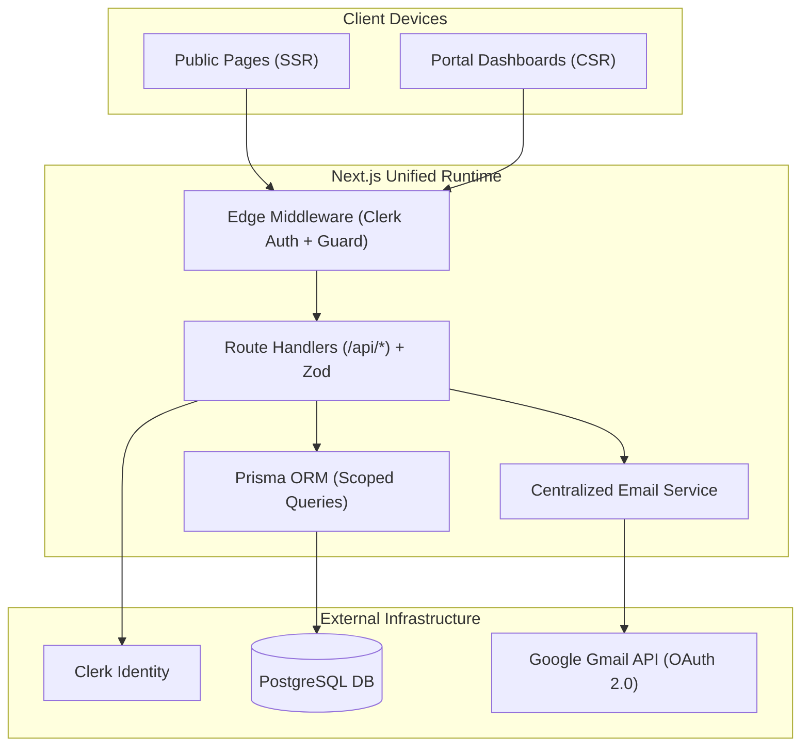
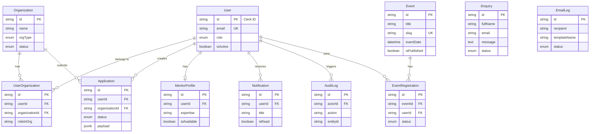
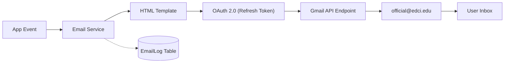

# EDCI Enterprise Website – Technical Blueprint & SRS

**Version:** 1.1 (Compact) | **Scope:** Public Institutional Portal + Multi-Tenant Enterprise Hub | **Team:** 6 Members

---

## 1. Project Overview & Boundaries

EDCI requires a unified Next.js application combining a **public institutional website** and a **secure multi-tenant enterprise portal** on a single database, auth engine, and API layer.

* **[CONFIRMED]:** Public site, role-based dashboards, Clerk auth, PostgreSQL, Gmail API email integration.
* **[ASSUMPTION]:** Application review workflow, cohort tracking, and standard student/startup self-registration.
* **[PENDING APPROVAL]:** Startup showcase directory, public mentor booking, external document storage provider.

---

## 2. Team & Technology Stack

```
Frontend: Samar (Lead/Arch), Yash (Public UI), Shivam (Bridge), Aayansh (Bridge)
Backend:  Pravesh (Lead/APIs), Prabhat (DB/Auth), Shivam (Bridge), Aayansh (Bridge)
```

| Layer | Stack | Purpose & Justification |
|---|---|---|
| **Core Framework** | Next.js (App Router, TS) | Unified SSR public pages + client portal + API Route Handlers. |
| **Styling & UI** | Tailwind CSS + Lucide Icons | Zero CSS bloat, rapid prototyping, unified design tokens. |
| **State & Fetching** | Zustand + TanStack Query | Zustand for UI state; TanStack Query for caching and API sync. |
| **Forms & Validation**| React Hook Form + Zod | Shared type-safe schemas across client forms and backend routes. |
| **Auth & RBAC** | Clerk Authentication | Managed sessions, social logins, role claims in `publicMetadata`. |
| **Database & ORM** | PostgreSQL + Prisma ORM | Relational integrity, type-safe queries, automatic migrations. |
| **Email Service** | Google Gmail API (OAuth 2.0) | Official EDCI Workspace mailbox; zero third-party email fees. |
| **DevOps & Logs** | Vercel + GitHub Actions + Sentry | Edge deployment, automated CI test gates, runtime error tracking. |

---

## 3. Role-Based Access Control (RBAC)

| Role | Operational Scope | Dashboard Focus | Data Boundary | Status |
|---|---|---|---|---|
| **Admin** | Global system management | User registry, content approvals, audit logs | System-wide (All data) | `[CONFIRMED]` |
| **Staff** | Daily operations & evaluations | Application review queue, enquiry inbox | Operational records only | `[CONFIRMED]` |
| **Enterprise** | Corporate partnerships & hiring | Proposals, student applications | **Org-Isolated** (`organizationId`) | `[CONFIRMED]` |
| **Startup** | Incubation & venture growth | Stage tracker, applications, mentor log | **Org-Isolated** (`organizationId`) | `[CONFIRMED]` |
| **Student** | Campus innovation & participation | Applications tracker, registered events | **User-Isolated** (`userId`) | `[CONFIRMED]` |
| **Mentor** | Startup guidance & evaluations | Assigned mentee roster, review forms | **Assignment-Isolated** | `[CONFIRMED]` |

*Tenant Rule:* All queries touching Partner/Startup records must enforce `where: { organizationId }` derived from the session.

---

## 4. Software Requirements Specification (SRS)

### Functional Requirements

```
[Public Website]
FR-01 [CONFIRMED]: Homepage with institutional mission, impact stats, and announcement feed.
FR-02 [CONFIRMED]: About page with leadership, advisory board, and incubation facility details.
FR-03 [CONFIRMED]: Programs page outlining student tracks, incubation cohorts, and enterprise offerings.
FR-04 [CONFIRMED]: Events calendar with details and one-click registration.
FR-05 [CONFIRMED]: Contact & enquiry form storing inquiries and alerting staff.
FR-06 [PENDING]:   Filterable Startup Showcase directory by sector.

[Authentication & Identity]
FR-07 [CONFIRMED]: User sign-up/sign-in via Clerk (Email/Password & Google OAuth).
FR-08 [CONFIRMED]: Email verification mandatory before dashboard access.
FR-09 [CONFIRMED]: Password resets and optional MFA managed via Clerk.
FR-10 [CONFIRMED]: Role assignment (default: Student; elevated by Admin).
FR-11 [CONFIRMED]: Route protection via Next.js middleware with automatic redirects.

[Enterprise Portal]
FR-12 [CONFIRMED]: Dynamic role-based dashboards rendered from Clerk session metadata.
FR-13 [CONFIRMED]: Profile editor for personal bio, skills, and resume links.
FR-14 [CONFIRMED]: Organization profile manager (logo, description, team roster).
FR-15 [CONFIRMED]: Multi-step incubation/funding application form with draft saves.
FR-16 [CONFIRMED]: In-app notification center for status alerts and announcements.
FR-17 [ASSUMPTION]: Directory of approved mentors with advisory request actions.

[Admin & Staff Panel]
FR-18 [CONFIRMED]: User management table with search, role modification, and account toggle.
FR-19 [CONFIRMED]: Enquiry management board with status flags (Unread/In Progress/Resolved).
FR-20 [CONFIRMED]: Application review pipeline (Draft -> Submitted -> Shortlisted -> Accepted/Rejected).
FR-21 [CONFIRMED]: CRUD content management for public events and announcements.
FR-22 [CONFIRMED]: Immutable audit log capturing user actions and administrative changes.

[Email Notification Engine]
FR-23 [CONFIRMED]: Automated Gmail API dispatch for sign-up, enquiry receipt, and application updates.
FR-24 [CONFIRMED]: Responsive HTML email templates with standardized EDCI branding.
FR-25 [CONFIRMED]: Persistent EmailLog storing recipient, template, status, and error traces.
FR-26 [CONFIRMED]: Non-blocking execution so email latency never delays user HTTP responses.
```

### Non-Functional Requirements (NFR)
* **NFR-01 (Security):** HTTPS-only; Zod payload sanitization; Clerk JWT verification on every route; CSRF protected.
* **NFR-02 (Performance):** Public Lighthouse score ≥ 90; LCP < 2.0s; API latency < 300ms.
* **NFR-03 (Scalability):** DB indexes on all foreign keys; connection pooling via Prisma Accelerate / Neon.
* **NFR-04 (Availability):** 99.5% uptime targeting backed by Vercel edge deployment.
* **NFR-05 (Responsiveness):** Mobile-first layouts validated from 375px to 1920px viewports.
* **NFR-06 (Maintainability):** TypeScript strict mode (`noImplicitAny`); zero unchecked lint warnings.

---

## 5. Technical Architecture



### Request-Response Lifecycle
1. **Client** dispatches request with Clerk JWT.
2. **Middleware** validates session and asserts role eligibility.
3. **Route Handler** validates payload against shared **Zod** schema.
4. **Prisma** executes query inside a transaction (`prisma.$transaction`).
5. **Email Service** triggers an asynchronous message via Gmail API.
6. **Client** receives sanitized JSON response in `< 300ms`.

---

## 6. Database Design (Prisma / PostgreSQL)



### Modeling Rules
* **PKs:** Clerk ID for `User.id`; `UUID` for all other entities.
* **Payload Flexibility:** `Application.payload` uses `jsonb` to support custom questions per cohort without schema migrations.
* **Compound Indexes:** `[organizationId, status]` on `Application`; `[eventId, userId]` UNIQUE on `EventRegistration`.
* **Tenant Scoping:** All queries touching organizations must include `where: { organizationId }`.

---

## 7. API Architecture

All endpoints follow REST principles under `/api/*` using Next.js Route Handlers:

| Endpoint | Method | Access Level | Description |
|---|---|---|---|
| `/api/auth/me` | `GET` | Authenticated | Returns current user profile, role, and organizations. |
| `/api/users` | `GET`, `PATCH` | Admin | Lists users with search/filter; modifies roles/status. |
| `/api/organizations` | `GET`, `POST` | Authenticated | Lists user's orgs; registers new Startup/Partner org. |
| `/api/applications` | `GET`, `POST` | Authenticated | Lists scoped applications; submits new application. |
| `/api/applications/[id]` | `GET`, `PATCH` | Owner / Staff / Admin | Details view; reviews or changes status. |
| `/api/events` | `GET`, `POST` | Public (`GET`), Staff (`POST`) | Lists events; creates announcements. |
| `/api/events/[id]/register` | `POST`, `DELETE`| Authenticated | Event RSVP toggle. |
| `/api/enquiries` | `POST` | Public | Captures contact submissions. |
| `/api/enquiries/admin` | `GET`, `PATCH` | Staff / Admin | Resolves enquiries and logs staff notes. |
| `/api/notifications` | `GET`, `PATCH` | Authenticated (Owner) | Fetches unread alerts; marks read. |

---

## 8. Gmail API & Email Architecture



* **Authentication:** OAuth 2.0 Web Client using a long-lived `GMAIL_REFRESH_TOKEN` with `gmail.send` scope.
* **Sender Identity:** Sent strictly from the official EDCI Google Workspace address.
* **Quota:** Up to 2,000 emails/day allowed by Google Workspace (EDCI volume: < 250/day).
* **Reliability:** Non-blocking dispatch; failures write to `EmailLog` without failing user operations.

---

## 9. Folder Structure (Next.js App Router)

```
src/
├── app/
│   ├── (public)/              # Public pages: page.tsx, about/, programs/, events/, contact/
│   ├── (auth)/                # Clerk auth: sign-in/[[...sign-in]]/, sign-up/[[...sign-up]]/
│   ├── (portal)/              # Authenticated: dashboard/, profile/, organization/, applications/
│   ├── (admin)/               # Staff/Admin: admin/users/, admin/enquiries/, admin/applications/
│   ├── api/                   # REST Route Handlers (auth, users, applications, events, enquiries)
│   └── layout.tsx             # Root layout with ClerkProvider & QueryClient
├── components/
│   ├── ui/                    # Primitives: button, input, dialog, table, badge (shadcn/radix)
│   ├── layout/                # Navbar, footer, portal sidebar, breadcrumbs
│   └── shared/                # DataTable, stat-card, empty-state
├── features/                  # Domain components: applications/, events/, organizations/
├── hooks/                     # Custom hooks: useCurrentUser, useDebounce
├── stores/                    # Zustand stores: useSidebarStore, useUIStore
├── services/                  # Business logic: email/ (gmail-client, templates), audit.ts
├── lib/                       # Singletons: prisma.ts, utils.ts
├── validations/               # Shared Zod schemas: application.ts, enquiry.ts, user.ts
└── types/                     # Shared TypeScript interfaces
```

---

## 10. Team Responsibility Matrix

| Member | Primary Ownership | Secondary Scope | Direct Deliverables |
|---|---|---|---|
| **Samar** | Frontend Architecture | UI Design System | Tailwind tokens, shared UI primitives (`components/ui/*`), layout shells, Zustand stores. |
| **Yash Pandey** | Public Institutional UI | Responsive Design & SEO | All public pages under `(public)/*`, mobile responsiveness, accessibility checks. |
| **Pravesh** | Backend Architecture | API Security & Routing | REST Route Handlers (`app/api/*`), Zod validations, server RBAC, Sentry setup. |
| **Prabhat** | Database & Authentication | Migrations & Data Models | Prisma schema, SQL migrations, seed scripts, Clerk webhook sync, tenant scoping. |
| **Shivam** | FE-BE Integration | Client Data Fetching | TanStack Query hooks, React Hook Form integration, API contract alignment. |
| **Aayansh** | Portal Views & Email | QA & Testing | Portal dashboard pages, Gmail API integration, end-to-end testing, bug triage. |

---

## 11. 13-Week Actionable Roadmap

```mermaid
gantt
    title EDCI 13-Week Development Schedule
    dateFormat  YYYY-MM-DD
    section Phases
    Phase 1: Requirements & UI/UX Design  :p1, 2026-11-10, 14d
    Phase 2: Frontend Foundation           :p2, 2026-11-24, 14d
    Phase 3: Database, Auth & Backend     :p3, 2026-12-01, 14d
    Phase 4: Public Website Implementation :p4, 2026-12-15, 14d
    Phase 5: Enterprise Portal & Admin    :p5, 2026-12-29, 21d
    Phase 6: API Integration & Gmail API  :p6, 2027-01-12, 14d
    Phase 7: Security Audit, QA & Launch  :p7, 2027-01-26, 14d
```

* **Phase 1 (W1–2) Entire Team:** Lock Figma designs, database dictionary, and API specs.
* **Phase 2 (W3–4) Samar, Yash, Shivam:** Next.js repo setup, Tailwind tokens, core UI component library.
* **Phase 3 (W4–5) Prabhat, Pravesh:** PostgreSQL setup, Prisma schema, migrations, Clerk route guards.
* **Phase 4 (W6–7) Yash, Samar, Shivam:** Public pages, responsive layouts, public enquiry endpoint.
* **Phase 5 (W8–10) Samar, Aayansh, Prabhat, Pravesh:** Role dashboards, application submission, admin tables.
* **Phase 6 (W10–11) Shivam, Aayansh, Pravesh:** TanStack Query hooks, Gmail API OAuth integration, email templates.
* **Phase 7 (W12–13) Entire Team:** Security audit, RBAC validation, Sentry monitoring, Vercel production deployment.

---

## 12. GitHub Collaboration Rules

* **Branches:** `main` (Production only), `develop` (Integration/Staging), `feat/*` (Features), `fix/*` (Bugs).
* **PR Policy:** Max 400 lines per PR; mandatory 1 peer review; passing CI check before merge.
* **CI Checks:** Automated GitHub Actions running `eslint`, `tsc --noEmit`, and `prisma validate`.
* **Commits:** Conventional Commits (`feat:`, `fix:`, `refactor:`, `chore:`).
* **Secrets:** Tracked via `.env.example`; production secrets managed in Vercel settings.

---

## 13. Critical Risks & Quick Mitigations

| Risk | Impact | Quick Mitigation |
|---|---|---|
| **FE/BE Schema Mismatch** | High | Shared Zod schemas in `validations/` imported by both client forms and API routes. |
| **Privilege Escalation** | Critical | Dual-layer security: Middleware checks routing; API handlers re-verify DB role before mutations. |
| **Tenant Data Leakage** | Critical | Mandatory `where: { organizationId }` clause on all partner/startup database queries. |
| **Gmail OAuth Expiry** | Medium | Use official Google token client with persistent refresh token; log dispatch failures gracefully. |
| **Migration Drift** | High | Prabhat owns all Prisma schema changes; team runs only checked-in migrations. |
| **Unsafe File Uploads** | High | Restrict uploads to PDF/PNG/JPEG under 5MB; store in secure cloud storage. |

---

## 14. Essential Stakeholder Questions

Before development begins, EDCI stakeholders must confirm:
1. **Public Content:** What is the finalized list of public pages and who provides the initial text/photos?
2. **Cohorts:** Are startup applications rolling or tied to fixed cohort deadlines?
3. **Partner Scope:** Can corporate partners post hiring listings directly or only partnership proposals?
4. **Mentorship:** Do startups select mentors directly or are they assigned manually by staff?
5. **File Hosting:** Which storage provider is approved for pitch decks (Vercel Blob vs AWS S3)?
6. **Email Sender:** Which specific Google Workspace mailbox will send official emails, and is admin consent granted?
7. **Production Domain:** What is the production domain (e.g., `edci.institution.edu`) and who manages DNS?
